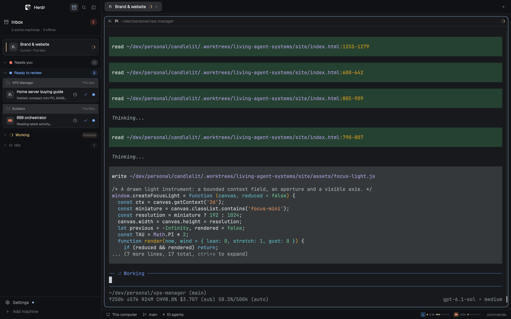
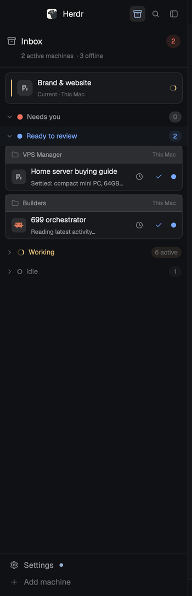

# Herdr Orchestrator Inbox

A terminal-first Herdr layout for supervising root orchestrators as an attention queue.



The Inbox answers two questions quickly: **why does this need me?** and **how do I clear it?** Root orchestrators appear under Needs you, Ready to review, Working, or Idle. Managed children stay nested beneath their root instead of becoming peer queue items.

## Highlights

- Root-only attention queue with nested child navigation
- Explicit acknowledge, 5-minute snooze, 1-hour snooze, and review state
- Immediate optimistic feedback backed by native `herdr.inbox` labels
- Activity wakes acknowledged or snoozed work early
- Finished sessions remain reviewable through a read-only retained transcript
- Terminal stays the primary workspace
- `⌘⇧I` toggles Inbox and Agents
- `⌘⇧J` / `⌘⇧K` cycle only actionable Inbox roots
- Compact rail when the Herdr sidebar is collapsed

<picture>
  
</picture>

## Requirements

- A current Herdr desktop release with `herdr-app` and `hc`
- Python 3 for safe shortcut merging in the installer
- macOS for the bundled key labels; replace `cmd` with your preferred modifier in `keys.json` on other platforms
- Root orchestrators and workers launched through `hc`, so Herdr records their parent tree

## Install

```bash
git clone https://github.com/asantos00/herdr-orchestrator-inbox.git
cd herdr-orchestrator-inbox
./install.sh
```

The installer:

1. checks shortcut conflicts,
2. backs up affected files under `~/.config/herdr-app/backups/`,
3. installs the layout and its two private-name mods,
4. merges the Inbox toggle into `keys.json`, and
5. runs `herdr-app check` on both mods.

Then activate the layout:

```bash
herdr-app do layout.switch '{"name":"orchestrator-inbox"}'
```

Herdr configuration hot-reloads. Existing terminals and agents are not restarted.

### Manual installation

Copy these files into your Herdr home:

```text
layouts/orchestrator-inbox.json
mods/orchestrator-inbox/
mods/orchestrator-workspace-chrome/
```

Merge the entries from the repository's `keys.json` into your own `keys.json`, then run:

```bash
herdr-app check ~/.config/herdr-app/mods/orchestrator-inbox
herdr-app check ~/.config/herdr-app/mods/orchestrator-workspace-chrome
```

## Shortcuts

| Shortcut | Action |
|---|---|
| `⌘⇧I` | Toggle Inbox / Agents |
| `⌘⇧J` | Next Needs you or Ready to review root (Herdr default) |
| `⌘⇧K` | Previous actionable root (Herdr default) |

Opening or navigating to work never acknowledges, snoozes, reviews, or clears it.

## How triage works

Triage history is persisted in the root terminal's native `herdr.inbox` label. Acknowledgement and snooze are bound to an activity fingerprint. New root or descendant activity invalidates stale handling and returns the root to Needs you when appropriate.

Finished child failures are historical context; only live blocked or errored descendants escalate their root. Finished roots remain under Ready to review until explicitly reviewed.

## Trust and permissions

Herdr mods are trusted native code. This layout:

- runs `hc ls`, `hc get`, `hc read`, and `hc label`,
- reads terminal metadata and bounded terminal output,
- writes only the `herdr.inbox` label,
- opens and focuses Herdr panes and overlays, and
- does not use the network, send terminal input, start daemons, or call a model.

Review `mods/orchestrator-inbox/main.js` before installing if those capabilities are sensitive in your environment.

## Uninstall

Switch to another layout, then run:

```bash
./uninstall.sh
```

The uninstaller backs up the affected files, removes only this package's layout/mod folders, and removes shortcuts only when they still match this package's values.

## Development

```bash
./scripts/test.sh
```

See [Getting started](docs/getting-started.md), [RECIPE.md](RECIPE.md) for the behavioral specification, and [CONTRIBUTING.md](CONTRIBUTING.md) for contribution guidance.

## License

Apache-2.0. See [LICENSE](LICENSE) and [NOTICE](NOTICE).
