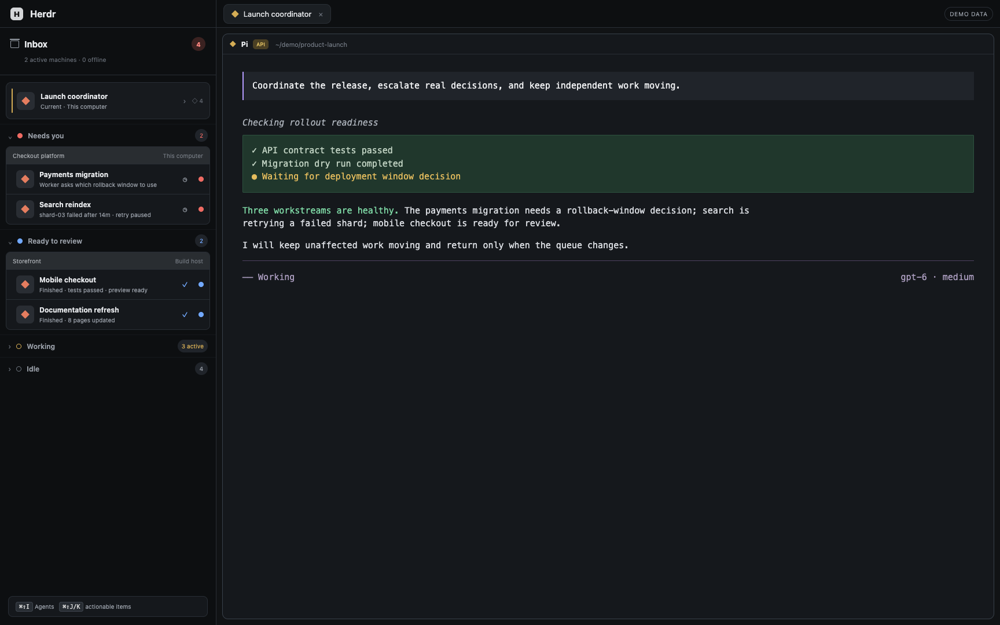

# Herdr Orchestrator Inbox

A terminal-first Herdr layout that turns root orchestrators into a compact attention queue while keeping the real terminal as the primary workspace.

## What you see

The window has a 268px left sidebar and the normal Herdr terminal workspace on the right.

The sidebar header says **Inbox**, reports active/offline machine counts, and shows the actionable root count. A current-session card appears below it. Four foldable sections follow:

1. **Needs you** — red status, expanded by default.
2. **Ready to review** — blue status, expanded by default.
3. **Working** — amber status, folded by default.
4. **Idle** — muted status, folded by default.

Rows are grouped by machine and space. Each root row is 44px high with its program icon, task/tab name, a bounded latest-activity summary, triage controls, and status mark. Managed descendants appear beneath the current root when expanded and never become peer Inbox rows.

Below 160px sidebar width, the Inbox becomes a compact icon rail. The normal terminal, tabs, pane header, file panel, and status bar remain unchanged.

## How it behaves

- A blocked/error root or live blocked/error descendant enters **Needs you**.
- A finished, unreviewed root enters **Ready to review**.
- Active roots without actionable state enter **Working**.
- Reviewed finished roots and inactive roots enter **Idle**.
- Historical failed children do not keep a working root actionable.
- Clicking a live root focuses its real agent terminal.
- Clicking a child focuses its existing pane or peeks at a live headless terminal.
- Clicking a finished retained root or child opens a selectable, read-only dialog backed by `hc read`. It shows the final agent result first and offers the full transcript on demand.
- Opening and navigation never acknowledge, snooze, review, or clear work.
- Acknowledge lasts one hour while the activity fingerprint is unchanged.
- Snooze lasts five minutes or one hour while the fingerprint is unchanged.
- Relevant root or descendant activity wakes acknowledged/snoozed work early.
- Review remains valid only for the completed activity fingerprint it covered.
- Action state updates optimistically, then confirms through `hc label`; success and failure use Herdr notifications.
- `⌘⇧I` toggles the sidebar between Inbox and shipped Agents.
- While Inbox is visible, `⌘⇧J/K` cycle only Needs you and Ready to review roots and wrap through the queue.
- While Agents is visible, shipped all-agent navigation order applies.
- The top Inbox button performs the same Inbox/Agents toggle.
- `⌘B` keeps Herdr's normal sidebar collapse behavior.

## Built from

`layouts/orchestrator-inbox.json` is a row with:

- a sidebar column containing `orchestrator-workspace-chrome`, a `sidebar-content` stack (`orchestrator-inbox` and shipped `agents`), shipped `spaces`, and a chrome footer;
- a work column containing shipped `tabs`, the terminal pane with shipped `pane`, optional shipped `files`/`changes`, and shipped `workspace-status`.

`mods/orchestrator-inbox/` uses:

- `agents()`, `terminals()`, `spaces()`, `machines()`, `focused()`, and `layout()` for reactive state;
- `hc` for `ls --all`, `get`, `read`, and `label`;
- `setAgentOrder()` for actionable keyboard navigation;
- `run()` for native pane/agent/layout commands;
- `openOverlay()` for retained transcript dialogs;
- native terminal labels (`herdr.inbox`) as shared triage truth.

`mods/orchestrator-workspace-chrome/` draws the top/footer chrome, preserves sidebar width, toggles Inbox/Agents, and receives the `orchestrator-workspace-chrome.toggle-inbox` command through `nextCommand()`.

The SVG icons are copied from Herdr's Apache-2.0 workspace-chrome mod and are attributed in `NOTICE`.

## Watch out

- `hc ls --all --json` summaries omit labels, so changed retained roots need `hc get --json` enrichment.
- Retained history is cached; fetch details only for new or changed roots instead of fanning out on every action.
- Root triage must ignore finished child failures while still reacting to live blocked/error descendants.
- Native `terminal.peek` supports running terminals only. Finished sessions require the Inbox-owned transcript dialog. Raw history can contain source code and tool chatter, so the dialog extracts the last post-`Thinking...` result and falls back to a bounded 60-line tail.
- The queue unit is always the root. Descendants contribute status/activity and navigation context but never become peer items.
- `herdr.inbox` history is bounded to 64 events.
- The layout assumes the shipped `agents`, `spaces`, `tabs`, `pane`, `files`, `changes`, and `workspace-status` mods exist.
- Keys must be merged rather than replacing a person's `keys.json`; installation stops on conflicting bindings.
- The package runs local `hc` commands and reads bounded terminal output. It performs no network request and sends no terminal input.

## Done when

- `node --test mods/orchestrator-inbox/*.test.mjs` passes.
- `herdr-app check mods/orchestrator-inbox` passes.
- `herdr-app check mods/orchestrator-workspace-chrome` passes.
- `layouts/orchestrator-inbox.json` parses and references only included or shipped mods.
- The installer refuses shortcut conflicts, creates a backup, and passes in an isolated Herdr home.
- Needs you, Ready to review, Working, and Idle classify roots as described.
- Finished failed children do not escalate a working root.
- Clicking a finished retained item opens its final result without preceding tool output, and the full retained transcript remains available.
- Inbox/Agents toggle and `⌘⇧J/K` preserve the focused terminal and never change triage state.
- The compact rail renders below 160px without changing the remembered expanded width.
